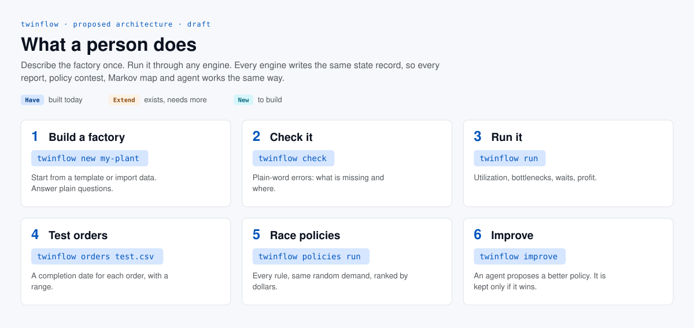
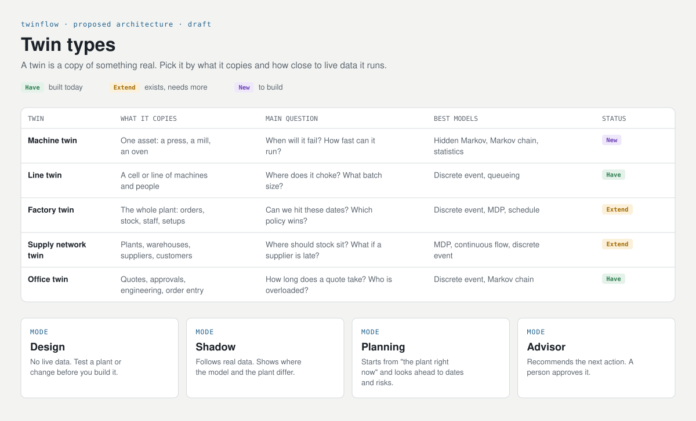
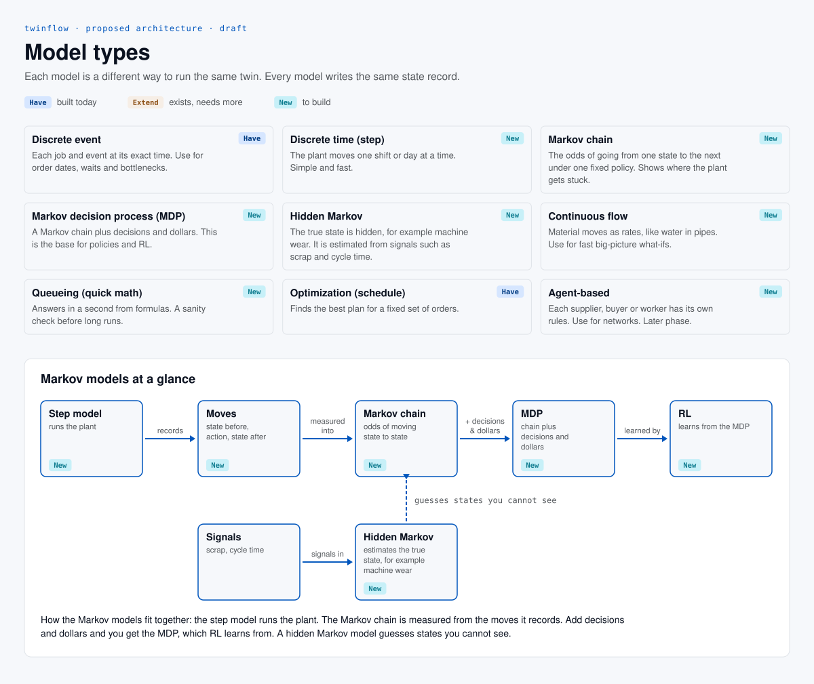
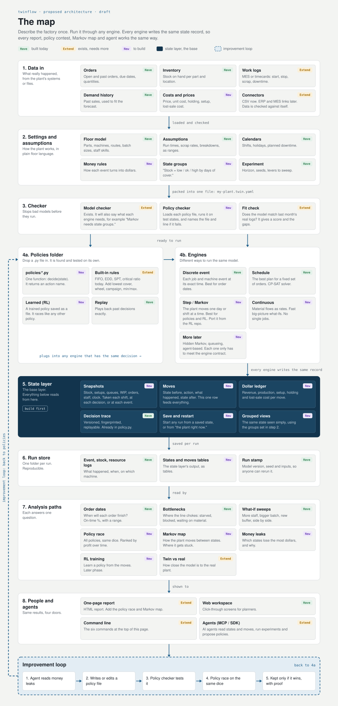
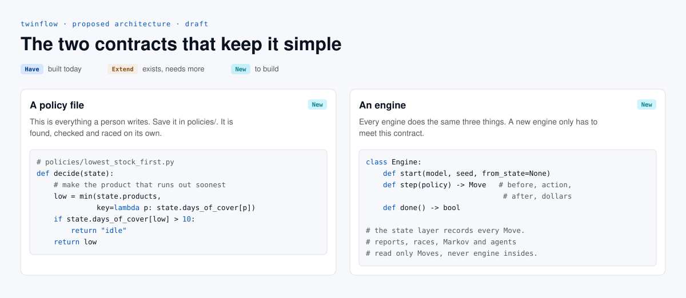
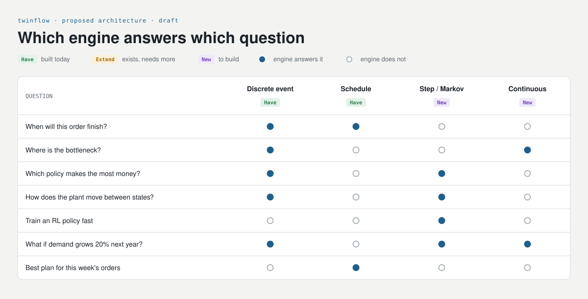
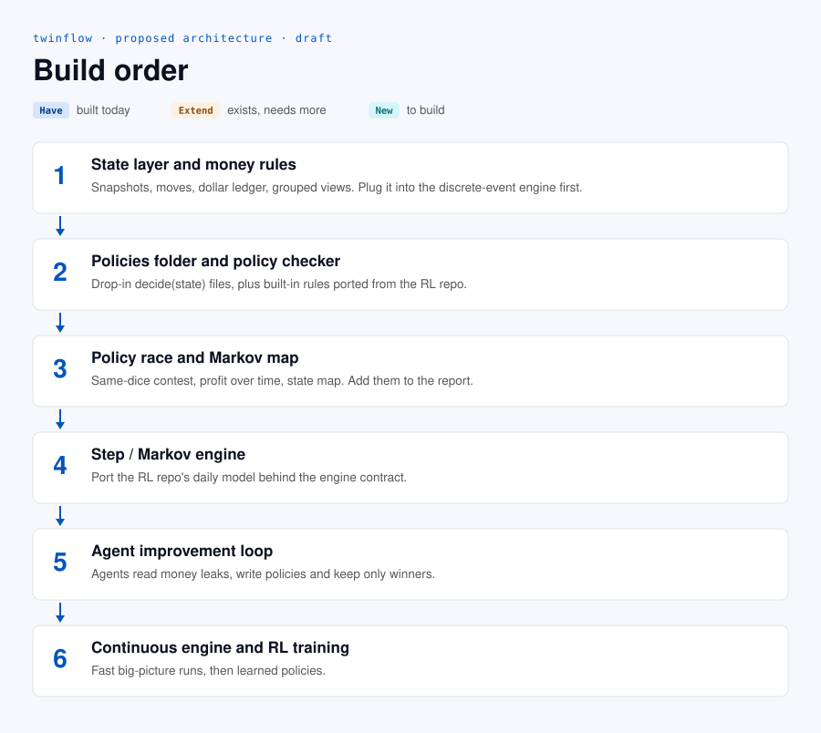

# Twinflow architecture images

Proposed architecture for twinflow, in page order. Each image is a standalone SVG.

1. 
   What a person does: the six steps and their commands.

2. 
   Twin types by what they copy, plus the four modes (Design, Shadow, Planning, Advisor).

3. 
   The nine model types and how the Markov models fit together.

4. 
   The eight layers, policies and engines side by side, the state layer, and the improvement loop.

5. 
   The two contracts: a policy file and an engine.

6. 
   Which engine answers which question.

7. 
   The six build steps, in order.
