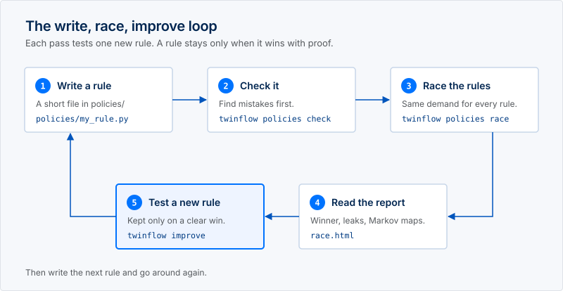

# How-to guides

These guides show you one job at a time. Read them in order the first time. After that, go to the page you need.

Each page has the same parts: what it does, what you need first, numbered steps, what you get, what to do when something goes wrong, and what comes next.

Commands in these guides start with `twinflow`. If you work from a source checkout of twinflow, put `uv run` in front of each command. For example: `uv run twinflow new --list`.

## The order to read the pages

1. [Build a twin](build-a-twin.md): start a new folder from a starter template.
2. [Load your data and economics](load-data-and-economics.md): enter your products, demand, prices and costs.
3. [Check your twin](check-your-twin.md): find mistakes before you run anything.
4. [Run your twin](run-your-twin.md): run a simulation and save the results.
5. [Test orders](test-orders.md): run a shop's orders and read the due-date results.
6. [Write a policy](write-a-policy.md): write your own rule for "what do I make next?"
7. [Write a reward, view, feature or demand](write-a-reward-view-feature-or-demand.md): change how days are scored, labeled, or how demand is drawn.
8. [Race your policies](race-your-policies.md): test many rules on the same random demand.
9. [Read the Markov map](read-the-markov-map.md): see how the plant moves from one state to the next.
10. [Improve a policy](improve-a-policy.md): test a new rule against your best one.
11. [Tune everything](tune-everything.md): learn where the default numbers are set.

For every command and flag, see the [CLI reference](../cli.md).

## The architecture map

This picture shows how the parts of twinflow fit together.

