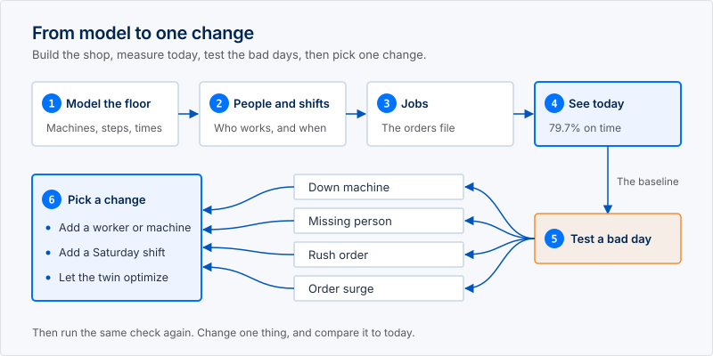
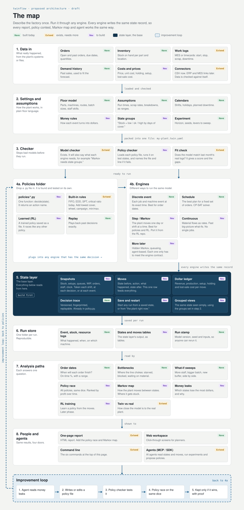

# How-to guides

These guides show you one job at a time. Read them in order the first time. After that, go to the page you need.

Each page has the same parts: what it does, what you need first, numbered steps, what you get, what to do when something goes wrong, and what comes next.

Commands in these guides start with `twinflow`. If you work from a source checkout of twinflow, put `uv run` in front of each command. For example: `uv run twinflow new --list`.

## The order to read the pages

There are two tracks. Read "Plan the floor" first. It is the everyday use: build a twin of your shop, add jobs and people, and test bad days. "Tune the rules" is for improving how the plant decides what to make next.

### Plan the floor

The picture shows the path. Build the shop, measure today, test the bad days, then pick one change.

1. [Build a twin](build-a-twin.md): start a new folder from a starter template.
2. [Load your data and economics](load-data-and-economics.md): enter your products, demand, prices and costs.
3. [Check your twin](check-your-twin.md): find mistakes before you run anything.
4. [Run your twin](run-your-twin.md): run a simulation and save the results.
5. [Model your floor](model-your-floor.md): describe your machines, steps and times in one shop file.
6. [Add people and shifts](add-people-and-shifts.md): set who runs the machines, when, and the days off.
7. [Add jobs](add-jobs.md): write the orders file and read one line per order.
8. [Test orders](test-orders.md): run a shop's orders and read the due-date results.
9. [Find your bottleneck](find-your-bottleneck.md): see which machine holds the shop back.
10. [Compare to today](compare-to-today.md): measure today once, then compare each what-if to it.
11. [Test a down machine](test-a-down-machine.md): will we ship if the mill breaks?
12. [Test a missing person](test-a-missing-person.md): what if a machinist is out?
13. [Test a rush order](test-a-rush-order.md): fit one hot order in, and see who pays.
14. [Test an order surge](test-an-order-surge.md): can we take 8 more orders?
15. [Test adding a worker or machine](test-adding-a-worker-or-machine.md): is a third machinist or a second mill worth it?
16. [Test a Saturday shift](test-a-saturday-shift.md): does an extra working day fix the late orders?
17. [Test a WIP cap](test-a-wip-cap.md): hold orders back until the floor has room.
18. [Change the dispatch rule](change-dispatch-rule.md): try a different "what next" rule at one machine.
19. [Optimize your floor](optimize-your-floor.md): let the twin search for the best change.

### Tune the rules

20. [Write a policy](write-a-policy.md): write your own rule for "what do I make next?"
21. [Write a reward, view, feature or demand](write-a-reward-view-feature-or-demand.md): change how days are scored, labeled, or how demand is drawn.
22. [Race your policies](race-your-policies.md): test many rules on the same random demand.
23. [Read the Markov map](read-the-markov-map.md): see how the plant moves from one state to the next.
24. [Improve a policy](improve-a-policy.md): test a new rule against your best one.
25. [Tune everything](tune-everything.md): learn where the default numbers are set.

For every command and flag, see the [CLI reference](../cli.md).

## The architecture map

This picture shows how the parts of twinflow fit together.

