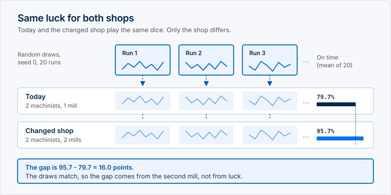
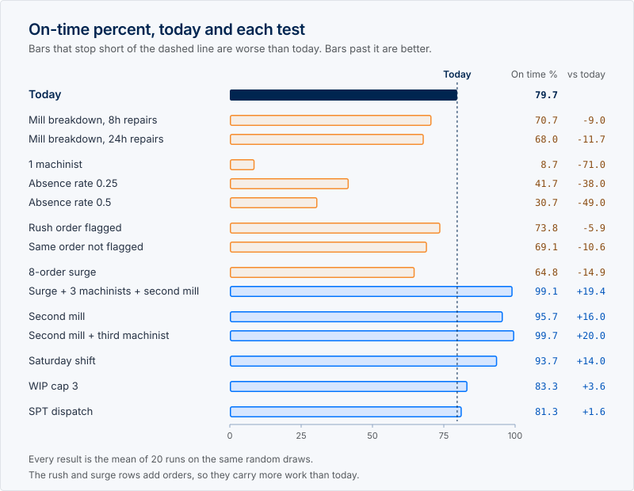

# Compare to today


This guide shows how to measure "today" once, then compare every what-if to it fairly.

## What this does

twinflow has no single command that puts a changed plan next to today's plan. You run twice and compare. This guide shows how to make the two runs fair, and gives the baseline numbers that the other guides use.

The picture shows why the two runs are fair. Today and the changed shop play the same random draws. The gap between them is the change, not luck.



## Before you start

- You did [Add jobs](add-jobs.md).
- The scenario files are in `examples/showcase/cnc-job-shop/scenarios/`.

## Steps

1. Know why the runs match. `twinflow run` and `twinflow balance` have no `--seed` flag. They always use seed 0, so the same files give the same numbers every time. A change in the numbers comes from your change. (`twinflow optimize` has a `--seed` flag. It only sets the search's own luck.)

2. Use 20 runs (`--reps 20`) every time, for today and for each what-if.

3. Get today's headline numbers. `balance` with a one-point file prints the mean on-time percent over all runs. The file `scenarios/today.json` has one point, 2 machinists, which is how the shop is today.

   ```bash
   twinflow balance examples/showcase/cnc-job-shop/shop.yaml --plan examples/showcase/cnc-job-shop/data/open-orders.csv --sweep examples/showcase/cnc-job-shop/scenarios/today.json --reps 20
   ```

   You will see:

   ```
     point        on_time_pct  busy_hours  levers
     ------------ ----------- -----------  ------
     point-0000          79.7       776.9  labor.pools[machinists].headcount=2
   ```

4. Get the late orders per run. Open `summary.json` in the folder the command printed. Today it says `"late_orders_per_run": 3.05`.

5. Run the what-if the same way. Change one thing only: the plan file, or one value in a sweep file. Keep the `--reps` the same.

6. Compare on three numbers: on-time percent, late orders per run, and the busiest machine from `run --orders`.

## What you get

Today, the CNC shop has:

- On-time: 79.7%.
- Late orders: 3.05 per run.
- Busiest machine: `mill_VB`, 93% of its on-shift time.

The other test guides compare to these numbers.

## Bad-day results

Each test guide ran 20 runs. This picture puts every result next to today. Bars below the dashed line are worse than today. Bars above it are better.



On-time percent over 20 runs, and the guide that made each number:

- Today: 79.7%.
- [Test a down machine](test-a-down-machine.md): 70.7% with 8-hour repairs, 68.0% with 24-hour repairs.
- [Test a missing person](test-a-missing-person.md): 8.7% with 1 machinist, 41.7% at absence rate 0.25, 30.7% at 0.5.
- [Test a rush order](test-a-rush-order.md): 73.8% flagged, 69.1% not flagged.
- [Test an order surge](test-an-order-surge.md): 64.8% with 8 more orders, 99.1% with 3 machinists and a second mill.
- [Test adding a worker or machine](test-adding-a-worker-or-machine.md): 95.7% with a second mill, 99.7% with a second mill and a third machinist.
- [Test a Saturday shift](test-a-saturday-shift.md): 93.7%.
- [Test a WIP cap](test-a-wip-cap.md): 83.3% with a cap of 3.
- [Change the dispatch rule](change-dispatch-rule.md): 81.3% with SPT.

## What it cannot do yet

- There is no command that runs two plans and prints the difference. You run twice.
- You cannot choose the seed of `run` or `balance`.

## If something goes wrong

- **Your numbers differ from this page**: Check that you used `--reps 20`, and that no file changed.
- **A one-point sweep looks odd**: It is a trick to get the means. The lever is set to today's value, so it changes nothing.

## Next

[Test a down machine](test-a-down-machine.md).
