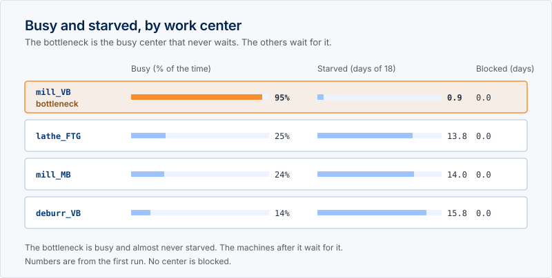

# Find your bottleneck


This guide finds the one machine that holds the shop back.

## What this does

It reads the busiest machines, and the wait breakdown, from a run of the CNC shop.

## Before you start

- You did [Add jobs](add-jobs.md).
- Know the terms. **Starved** means a machine sat idle with nothing to work on. **Blocked** means it finished a job and could not hand it on. **Material-starved** means it waited for material that had run out.

## Steps

1. Run the open orders.

   ```bash
   twinflow run examples/showcase/cnc-job-shop/shop.yaml --plan examples/showcase/cnc-job-shop/data/open-orders.csv --reps 20 --orders
   ```

   The last line names the three busiest centers:

   ```
   Busiest work centers: mill_VB 93% | mill_MB 31% | lathe_FTG 22% (busy share of on-shift time)
   ```

2. Open the `report.html` the command printed. The overview names the choke point in words: "The mill vb is the choke point. It is busy 95% of the time."

3. Check the wait breakdown in the report. The bottleneck is busy and almost never starved. The machines after it are idle and starved. For the first run, in days:

   ```
   centre        busy   starved   blocked
   mill_VB        95%      0.9       0.0
   lathe_FTG      25%     13.8       0.0
   mill_MB        24%     14.0       0.0
   deburr_VB      14%     15.8       0.0
   ```

## What you get

The picture shows the table from step 3. The bottleneck is busy and almost never starved. The machines after it wait for it.



- One clear answer: `mill_VB`, the valve-body mill. It is busy 95% of the time, and starved for under a day of an 18-day run.
- No machine is blocked, so no machine is held up by a full line after it.
- Every late order is a valve body, so fixing the mill fixes the dates. Go on to [Test adding a worker or machine](test-adding-a-worker-or-machine.md).

## If something goes wrong

- **Two machines are both near 100%**: Fix the first one. The second may be next.
- **Material-starved is 0**: This shop has no limited stock, so no machine waits for material.

## Next

[Compare to today](compare-to-today.md): measure today once, then test bad days against it.
