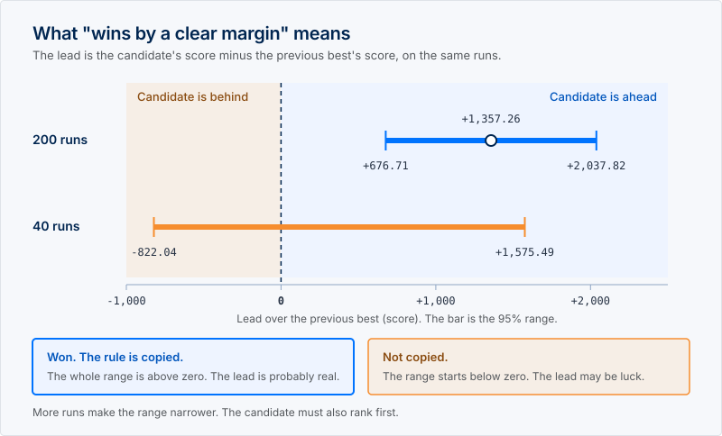

# Improve a policy


This guide tests a new rule against your best rule. The new rule is copied into your plant only when it wins by a clear margin.

## What this does

It races a candidate rule against the rules already in your `policies/` folder, on the same random demand. Then it decides whether to keep the candidate.

## Before you start

- You have a plant folder with at least one rule in `policies/`. See [write a policy](write-a-policy.md).
- You have a candidate file. This is a new rule, saved as a `.py` file. A simple way to start: copy a rule from `policies/` and change its numbers. Give the copy a new `NAME`.

## Steps

1. Run the test. Give the plant folder and the candidate file.

   ```bash
   twinflow improve my-plant --candidate my_rule.py
   ```

   The default is 200 runs per rule. Use `--episodes` to change it.

2. Read the output. This is a sample:

   ```
   Racing my_rule against 2 of the policies in this project on 200 runs each (seed 0).
     my_rule (full): 66,734.55
     family_campaign (full): 65,377.29
     lowest_stock_first (full): 43,667.82
   Candidate my_rule: score 66,734.55, dollars $66,735 per run (settings: target_days=10).
   Previous best family_campaign: score 65,377.29, dollars $65,377 per run (settings: target_days=16).
   Candidate minus previous best, same draws: score +1,357.26 (95% range +676.71 to +2,037.82)
   Won. Copied my_rule.py to my-plant/policies/my_rule.py.
   Proof: my-plant/runs/improve-.../improve.json
   ```

3. If the candidate did not win, the output says why. This is a real example from a 40-run test:

   ```
   Not copied: It ranks first, but its lead over family_campaign is not proven: the 40-run range runs from -822.04 to 1,575.49, and a win needs the range above zero. It may be luck. Raise --episodes to test again.
   ```

## What "wins by a clear margin" means



A candidate is copied only when both of these are true:

1. It ranks first.
2. The 95% range of its lead over the previous best is above zero. "Lead" means the candidate's score minus the previous best's score, on the same runs.

A range that starts below zero means the lead might be luck. A range that starts above zero means the lead is probably real.

If the candidate is close, run it again with more runs. For example, `--episodes 200` or more. The range gets narrower with more runs.

## Where the proof goes

The command writes `improve.json`, plus `race.json` and `race.html`, into a new folder under `runs/`. Use `--out` to pick the folder. The `improve.json` file holds the proof. Some of its fields:

```json
{
  "promoted": true,
  "rule": "interval_above_zero",
  "interval": 0.95,
  "candidate": {"name": "my_rule", "settings": {"target_days": 10}},
  "previous_best": {"name": "family_campaign", "settings": {"target_days": 16}},
  "versus": {"score": {"mean": 1357.26, "low": 676.71, "high": 2037.82}}
}
```

- `promoted` is `true` when the candidate was copied.
- `interval` is the level of the range, 0.95 for 95%.
- `versus` is the lead of the candidate over the previous best. Its `low` and `high` are the range.

## What you get

- When the candidate wins, its file is copied into `policies/`. The output names the new path.
- When it does not win, nothing is copied. The output gives the reason. Exit code is 0 either way.

## If something goes wrong

- **"already exists. ... add --replace to overwrite it if it wins"**: A file with the same name is already in `policies/`. Rename your candidate, or add `--replace` to overwrite the old file if the candidate wins.
- **"is not a policy file"** for a file that does not exist: Check the file name and the path. The message can appear when the file is just missing.
- **"Not copied"**: The lead is not proven yet. Run again with more runs, or improve the rule and test it again.
- **A rule crashes**: The test stops with exit code 1 and names the line. Fix the line in the candidate file.

## Next

[Tune everything](tune-everything.md): learn where the default numbers are set.
