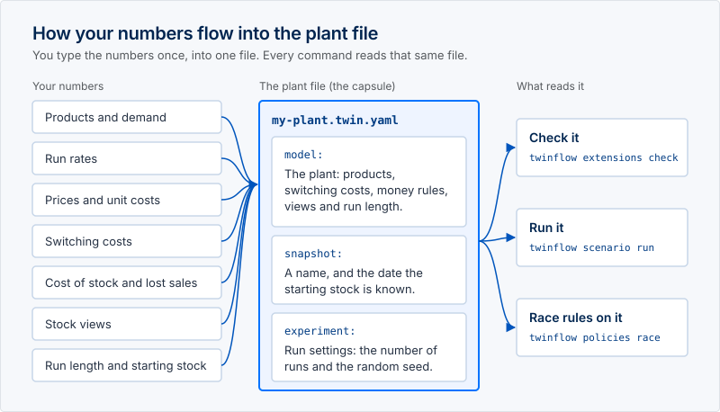

# Load your data and economics


This guide shows what goes in the plant file. It also explains each part.

## What this does

The plant file (named `something.twin.yaml`) holds your products, demand, run rates, prices, costs and the stock views.

## Before you start

- You have a folder from [build a twin](build-a-twin.md).
- You have these numbers ready: sales per day, units made per day, prices, unit costs, and switching costs. Use your finance team's numbers when you have them.
- Use any plain text editor to open the file.

## Steps

1. Open the plant file, for example `my-plant/my-plant.twin.yaml`.

2. Enter the products. Each line under `products:` is one product. This is one line from the molding press:

   ```yaml
   products:
     - {id: GRY-S, family: grey, abc: A, demand: 60, run_rate: 450, price: 12.0, unit_cost: 7.2, max_storage: 1500}
   ```

   - `id`: the product name. Keep it short and unique.
   - `family`: the group the product belongs to, such as a color. Switching inside a family costs less.
   - `abc`: `A` for fast sellers, `B` for middle sellers, `C` for slow sellers.
   - `demand`: average units sold per day.
   - `run_rate`: units you can make in a full day.
   - `price`: sale price for one unit, in dollars.
   - `unit_cost`: cost to make one unit, in dollars.
   - `max_storage`: the most units you can keep in stock.

3. Enter the switching costs. This is what it costs to change from one product to another.

   ```yaml
   line:
     id: press
     changeover:
       within_family: {cost: 200, output_lost: 0.10}
       across_family: {cost: 1200, output_lost: 0.50}
   ```

   - `within_family` is a switch to a product in the same family. It costs $200 and loses 10% of the day.
   - `across_family` is a switch to a new family. It costs $1,200 and loses half the day.

4. Enter the money rules. These set the cost of keeping stock and the cost of a lost sale.

   ```yaml
   model:
     economics:
       defaults: {holding_rate: 0.01, lost_sale_rate: 0.30}
   ```

   - Keeping stock costs 1% of the unit cost each day.
   - A lost sale costs 30% of the price.

   A job shop uses money per part instead. This is from the job-shop starter:

   ```yaml
   model:
     economics:
       things:
         shaft: {price: 90, unit_cost: 40, late_cost_per_day: 500}
         round_bar: {holding_per_unit_day: 0.5}
       setup: {cost: 75}
   ```

   If you leave out a money value, it counts as $0. twinflow then adds a note to the results.

5. Enter the stock views. These tell the reports how to label stock levels.

   ```yaml
   model:
     state_groups:
       views:
         simple:
           stock:
             by: days_of_cover
             aggregate: family
             levels: [{name: out, below: 1}, {name: low, below: 4}, {name: ok, below: 10}, {name: high}]
           setup: family
   ```

   A family is "out" when it has under 1 day of stock. It is "low" under 4 days, "ok" under 10 days, and "high" above that.

6. Set the run length and the starting stock.

   ```yaml
   model:
     period: day
     horizon: 60
     start_cover_days: 8
   ```

   - `horizon` is the number of days in one run.
   - `start_cover_days` is the days of stock each product starts with.

## What is in the file



- `model:` holds the plant: products, switching costs, money rules and views.
- `snapshot:` holds a name and the date the starting stock is known.
- `experiment:` holds run settings, such as the number of runs and the random seed. See [tune everything](tune-everything.md).

## What you get

- Nothing prints when you save the file. The file is the plant description.
- Check the file before you run it. See [check your twin](check-your-twin.md).

## If something goes wrong

- **"is not a known field here"**: A field name is misspelled. For example, `demnad` shows this message. Fix the spelling to `demand`.
- **"demand is missing"**: A product has no `demand` value. Add one.
- **"is not a number"**: A number has a word in it. For example, `horizon: sixty` fails. Write `horizon: 60`.

## Next

[Check your twin](check-your-twin.md): find mistakes before you run.
