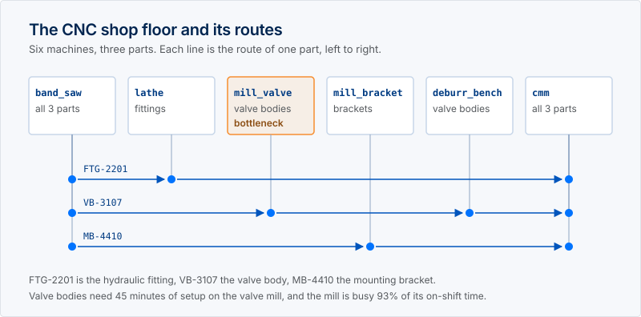

# Model your floor


This guide shows how to describe your machines, steps and times in one shop file. It uses the CNC shop example.

## What this does

It walks through `shop.yaml` part by part. You then copy the parts that fit your floor. People, shifts and orders have their own guides.

The picture shows the shop in the example. Each box is a machine. Each line is the route of one part.



## Before you start

- twinflow is installed.
- The example is in `examples/showcase/cnc-job-shop/` of the twinflow folder.
- Know your machines, the steps each part goes through, and how long each step takes.

## Steps

1. Open `examples/showcase/cnc-job-shop/shop.yaml`. Find `machines:`. List each machine once.

   ```yaml
   machines:
     - {name: mill_valve}   # Haas VF-2 mill for valve bodies
   ```

2. Find `locations:`. Each entry is one step of one part, such as `mill_VB`. It names the `machine` it runs on, what it uses (`consumes`) and what it makes (`emits`). Two steps can share a machine.

3. Set the time of each step in `time_model`. `rate` is pieces per second. `load` is the setup time of each job, in seconds.

   ```yaml
   time_model: {kind: rate_based, rate: 0.0003704, load: 2700}
   ```

   A rate of 0.0003704 is one piece every 45 minutes. The setup is 45 minutes.

4. Find `routing:`. It lists the steps of each part in order.

   ```yaml
   - {part: VB-3107, steps: [saw_VB, mill_VB, deburr_VB, inspect_VB]}
   ```

5. Find `economics:`. It sets the price, cost and late fee of each part. The late fee is per day.

6. Leave `bom: []` alone. A bom is a bill of materials, the list of parts that go into a part. The twin works it out from what each step uses and makes, so this shop keeps it empty.

7. Check the file, then run the open orders once.

   ```bash
   twinflow validate examples/showcase/cnc-job-shop/shop.yaml
   twinflow run examples/showcase/cnc-job-shop/shop.yaml --plan examples/showcase/cnc-job-shop/data/open-orders.csv --reps 20 --orders
   ```

   `validate` prints nothing when the file passes. The run ends with a line like this:

   ```
   Busiest work centers: mill_VB 93% | mill_MB 31% | lathe_FTG 22% (busy share of on-shift time)
   ```

## What you get

- A shop file the twin can run.
- A first answer: mill_VB is busy 93% of its on-shift time. It is the machine to watch.

## If something goes wrong

- **"step names location 'mill_XX', which is not declared"**: Each step in `steps` must match a `name` in `locations`. Check the spelling.
- **A time looks wrong**: `rate` is pieces per second, not per hour. Divide 1 by the seconds for one piece.

## Next

[Add people and shifts](add-people-and-shifts.md): say who runs the machines, and when.
