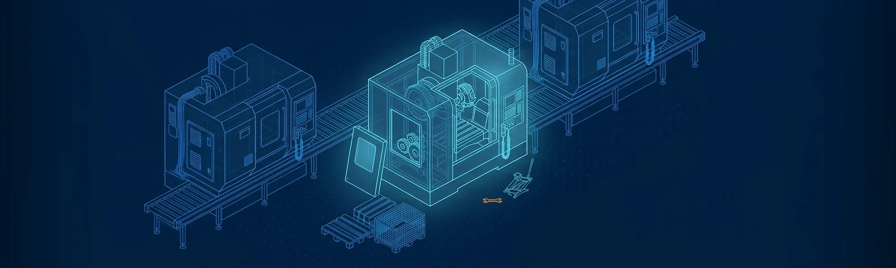

# Test a down machine



This guide answers one question. Will we still ship if the valve-body mill breaks down?

## What this does

It adds random breakdowns to the mill. It then compares the on-time percent to today.

## Before you start

- You did [Compare to today](compare-to-today.md). Today is 79.7% on time, 3.05 late orders per run.
- The file `scenarios/mill-breakdown.json` has three points: no breakdowns, short repairs, long repairs.

## Steps

1. Look at the file. A breakdown is `mtbf` (mean time between failures) and `mttr` (mean time to repair). `null` means no breakdowns.

   ```json
   {"locations[mill_VB].breakdown": [null,
     {"mtbf": "80h", "mttr": {"dist": "lognormal", "mean": "8h", "cv": 0.4}},
     {"mtbf": "80h", "mttr": {"dist": "lognormal", "mean": "24h", "cv": 0.4}}]}
   ```

   The mill fails about every 80 hours. It is down 8 hours on average in the second point, and 24 hours in the third.

2. Run it.

   ```bash
   twinflow balance examples/showcase/cnc-job-shop/shop.yaml --plan examples/showcase/cnc-job-shop/data/open-orders.csv --sweep examples/showcase/cnc-job-shop/scenarios/mill-breakdown.json --reps 20
   ```

   You will see:

   ```
     point        on_time_pct  busy_hours  levers
     ------------ ----------- -----------  ------
     point-0000          79.7       776.9  locations[mill_VB].breakdown=None
     point-0001          70.7       769.9  locations[mill_VB].breakdown={'mtbf': '80h', 'mttr': {'dist': 'lognormal', 'mean': '8h', 'cv': 0.4}}
     point-0002          68.0       746.5  locations[mill_VB].breakdown={'mtbf': '80h', 'mttr': {'dist': 'lognormal', 'mean': '24h', 'cv': 0.4}}
   ```

3. Read it against today. Point 0 is today. A shift-long repair drops on-time by 9 points. A day-long repair drops it by 12 points. The late orders per run rise from 3.05 to 4.4 and 4.8 (see `summary.json`).

## What you get

See where this test sits next to the others in the [bad-day results](compare-to-today.md#bad-day-results).

A short repair costs about as many orders as a long one. The mill has no slack, so any lost hour pushes orders later. Plan a spare hour or a second mill before you plan for fast repairs.

## What it cannot do yet

- You cannot say "the mill is down Tuesday 8 to noon". Breakdowns are random, from `mtbf` and `mttr` (`src/twinflow/model/compile.py:183`).
- A scripted outage exists only in the planning profile (`ScriptedOutage`, `src/twinflow/execution/policy.py:128`). The shop file cannot reach it.
- A breakdown waits for the job on the machine to end. It never stops a job in the middle.

## If something goes wrong

- **"error: 'breakdown'"**: You wrote `locations[mill_VB].breakdown.mtbf`. The shop has no `breakdown` yet, so set the whole `breakdown` value, as above.

## Next

[Test a missing person](test-a-missing-person.md).
