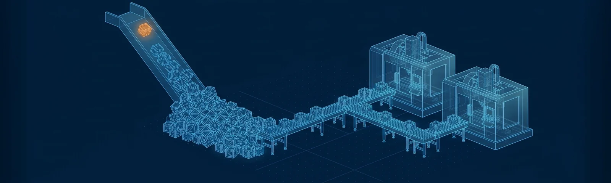

# Test an order surge



This guide answers one question. Can we take 8 more orders in the second week?

## What this does

It adds 8 orders to the open orders and runs the shop. You compare it to today.

## Before you start

- You did [Compare to today](compare-to-today.md). Today is 79.7% on time, 3.05 late orders per run.
- The file is `scenarios/order-influx.csv`. It is the 15 open orders plus 8 new ones, `WO-26117` to `WO-26124`. They start on Nov 23 to 25 and are due Dec 1 to 4.

## Steps

1. Run it.

   ```bash
   twinflow run examples/showcase/cnc-job-shop/shop.yaml --plan examples/showcase/cnc-job-shop/scenarios/order-influx.csv --reps 20 --orders
   ```

   Your run ID will differ. Some lines are left out:

   ```
     orders:   23/23 complete  |  on-time 15 (65%)  |  late 8 (rep 1 of 20)
     makespan: 701.9 h
   WO-26115  VB-3107   40   Fri Dec 04 24:00  Tue Dec 15 12:07  Wed Dec 16 13:11  20 of 20
   WO-26124  VB-3107   30   Fri Dec 04 24:00  Fri Dec 11 12:24  Mon Dec 14 09:18  20 of 20
   Busiest work centers: mill_VB 95% | mill_MB 28% | lathe_FTG 21% (busy share of on-shift time)
   ```

2. Get the mean on-time percent for the same file, as in [Compare to today](compare-to-today.md).

   ```bash
   twinflow balance examples/showcase/cnc-job-shop/shop.yaml --plan examples/showcase/cnc-job-shop/scenarios/order-influx.csv --sweep examples/showcase/cnc-job-shop/scenarios/today.json --reps 20
   ```

   ```
     point-0000          64.8     1261.1  labor.pools[machinists].headcount=2
   ```

3. Read it. On-time falls from 79.7% to 64.8%. Late orders per run rise from 3.05 to 8.1. In the first run, the whole book finishes at hour 702, not hour 447. The new orders are fittings and brackets as well as valve bodies, but only the valve bodies are late. The mill is the limit again.

## What you get

See where this test sits next to the others in the [bad-day results](compare-to-today.md#bad-day-results).

The surge lands on the valve-body mill, as the open orders do. Fittings and brackets still ship on time. To take the surge, test more mill and more people together. With 3 machinists and a second mill the surge ships 99.1% on time. With either one alone it does not (66.7%). Use [Test adding a worker or machine](test-adding-a-worker-or-machine.md) with this file.

## What it cannot do yet

- You write the new orders into a file by hand. There is no "add 8 orders like these" switch.
- You cannot test a surge with a probability. The 8 orders always arrive.

## If something goes wrong

- **"unknown part" or a date error**: See [Add jobs](add-jobs.md).
- **Orders finish after your test**: Nothing is cut off. The run goes on until every order is done.

## Next

[Test adding a worker or machine](test-adding-a-worker-or-machine.md).
